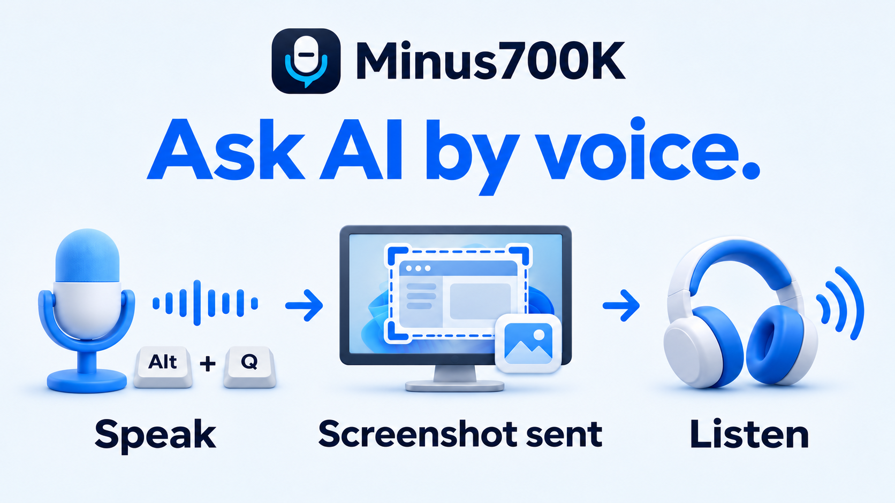

# Minus700K

**"What is this?"**
**AI: "What you see on the screen right now is the GitHub page for an AI-integration app by LSOUL."**


Minus700K is a Windows tool that lets you ask AI questions by voice and hear the answers aloud while keeping your game or work app open.  
You can attach a screenshot of the current window and ask questions such as “What does this error mean?” or “What should I do next?”

[日本語](README.md) | [Contributing](CONTRIBUTING.md)

## Download

**[Download Minus700K 1.0 for Windows x64](https://github.com/LSOUL-K/Minus700K/releases/download/v1.0.0/Minus700K-Setup.exe)**

[Release notes](https://github.com/LSOUL-K/Minus700K/releases/tag/v1.0.0) | [SHA-256 checksum](https://github.com/LSOUL-K/Minus700K/releases/download/v1.0.0/Minus700K-Setup.exe.sha256)

## Requirements

- Windows 10/11 (x64) and .NET Framework 4.8
- A microphone, speakers or headphones, and a Windows text-to-speech voice (including a Japanese voice if you use the app in Japanese)
- A ChatGPT account that supports connecting to this app, and an internet connection

No OpenAI API key is required. The AI service is subject to your account's terms and usage limits.

## Getting started

The app is installed **for the current Windows user only**, normally in `C:\Users\<username>\AppData\Local\Programs\Minus700K`.

1. Open **`Minus700K-Setup.exe`**, choose a language, and follow the installer. The selected language also applies to the app. The speech recognition engine is included, and Codex CLI is installed automatically if needed.
2. Leave **Start Minus700K** selected on the completion screen. On first launch, the app downloads its speech recognition model (about 190 MB), then opens the **Connection** tab in Settings. An internet connection is required for this download; if it fails, select **Retry** or restart the app later.
3. Select **Continue with ChatGPT**, then sign in and grant permission in your browser.

To start the app later, open **Minus700K** from the Windows Start menu. To return to the connection settings, double-click its notification-area icon and select **Connection**.

Windows may ask for administrator approval when installing a required speech recognition component.

Before uninstalling, choose **Exit** from the Minus700K notification-area icon and close any open settings or other app windows. If the app is still running, the uninstaller stops without deleting application files.

## Basic controls

Keep the game or app you want to ask about in the foreground, then **hold Alt+Q to speak and release it to send your question**. The answer is read aloud, and you can continue working while you wait.

| Shortcut | Action |
|---|---|
| **Alt+Q** | Record while held; release to send |
| **Alt+E** | Cancel recording, answer processing, or speech playback |
| **Alt+R** | Read the last answer aloud again |

You can change these keys in Settings.  
Screen capture is ON by default. The app captures the foreground window once when recording starts. If you do not want to send an image, turn off **General → Use screen capture**. If capture fails, your question continues without an image.

To quit, right-click the notification area icon and select **Exit**.

## Settings

Double-click the notification area icon to open Settings.

| Tab | Main settings |
|---|---|
| General | Display language, keyboard shortcuts, screen capture |
| Audio | Microphone, speakers, reading voice, speech rate and volume, sound effects and waiting sounds |
| Search | Web Search mode, automatic retry, search keywords |
| Custom instructions | Preferences such as answer length and writing style |
| Memory and history | Number of recent exchanges kept in memory, debug logging |
| Connection | ChatGPT sign-in, sign-out, answer model, usage |
| Advanced | Advanced settings such as recording duration, answer timeout, and speech recognition language |

After making changes, select **Save and apply** or press **Ctrl+S**. If recording or answer processing is in progress, wait for it to finish or cancel with Alt+E before saving.

To choose an answer model, select **Connection → Load available models**. If you need to sign in again, authenticate using **Continue with ChatGPT**.

Japanese and English are supported. You can change the language under **General → Application language**.

## Useful tips

- **Search the web:** The default mode is **When needed**. Say “Search the web for this” or include a web search keyword in your question to search. The app automatically searches again if needed. Say “Don't search the web” to skip searching for that question.
- **Ask follow-up questions:** Every request includes the exchanges still held in memory, and the AI uses relevant context. No special wording is required: “What about the other option?” also works. Change the memory limit under **Memory and history**.
- **Adjust the answers:** Enter preferences such as “Keep answers short” or “Explain for a beginner” under **Custom instructions**.

## How this app came to be

This app was born from losing $700K(110,000,000 yen) in the AI stock crash.  
Any support is deeply appreciated.  
Elon Musk, please send help.

```text
$5 / $700,000 (0.0007%)
```

- ### GitHub Sponsors： [Support development](https://github.com/sponsors/LSOUL-K)
- ### Ko-fi： [Donate on Ko-fi](https://ko-fi.com/lsoul)
- ### Bitcoin：  bc1q4kvzh4dthqpcrerzh6deww9zw7m220cd05ufj5

You can also help by reporting reproducible bugs, suggesting improvements, and contributing translations. Japanese and English contributions are welcome. See [CONTRIBUTING.md](CONTRIBUTING.md).

## License

The app is free, open-source software available under the [MIT license](LICENSE). For dependency licenses, see the [third-party notices](THIRD-PARTY-NOTICES.md).

Minus700K is not an official OpenAI application.
