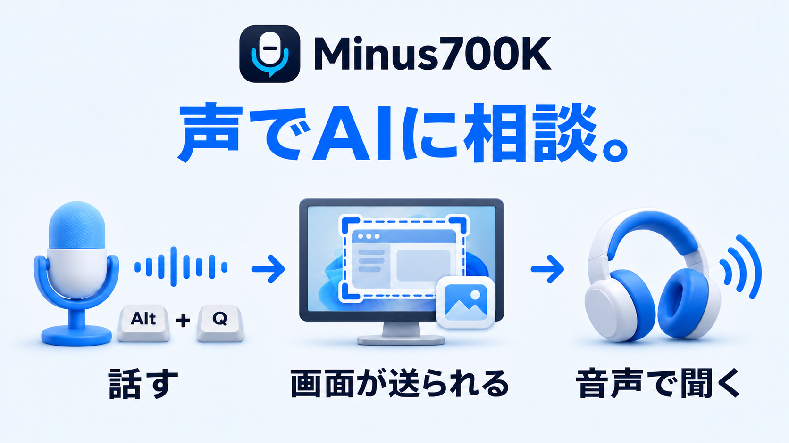

# Minus700K

**「これなに？」**
**AI「今画面に映っているのは、LSOULによるAI連携アプリのGitHubページです」**


ゲームや作業中のアプリを開いたまま、声でAIに質問し、回答を音声で聞けるWindows用ツールです。
表示中の画面を添付して「このエラーの意味は？」「次は何をすればいい？」と質問できます。

[English](README.en.md) | [開発への参加](CONTRIBUTING.md)

## 必要な環境

- Windows 10/11（x64）、.NET Framework 4.8
- マイク、スピーカーまたはヘッドホン、Windowsの読み上げ音声（日本語で使う場合は日本語音声）
- 本アプリへの接続に対応したChatGPTアカウントとインターネット接続

OpenAI APIキーは不要です。AIサービスの利用には、アカウントごとの利用条件・利用枠が適用されます。

## はじめかた

本アプリは**Windowsユーザーごとにインストール**されます。通常のインストール先は `C:\Users\<ユーザー名>\AppData\Local\Programs\Minus700K` です。

1. **`Minus700K-Setup.exe`** を開き、言語を選んでインストールします。選んだ言語がアプリにも反映されます。音声認識エンジンは同梱され、Codex CLIは必要な場合に自動で導入されます。
2. 完了画面で **「Minus700Kを起動する」** が選択されていると、アプリが起動します。初回は音声認識モデル（約190MB）をダウンロードした後、設定画面の **「接続」** タブが開きます。取得にはインターネット接続が必要です。失敗した場合は **「再試行」** を選ぶか、後からアプリを起動し直してください。
3. **「Continue with ChatGPT」** を選び、ブラウザーでログインして利用を許可します。

後から起動するときは、スタートメニューの **Minus700K** を開きます。接続設定は、通知領域のアイコンをダブルクリックして「接続」から開けます。

更新も同じインストーラーで行えます。起動中は録音・回答処理・読み上げ・接続処理の完了を待って自動終了し、更新後に再起動します。未保存の設定と、メモリ内だけの会話は終了時に破棄されます。
音声認識に必要な部品の導入時に、Windowsから管理者の許可を求められる場合があります。

アンインストールする際は、通知領域のMinus700Kアイコンから「終了」を選び、開いている設定画面なども閉じてください。アプリが実行中の場合はアンインストールを中止し、ファイルを削除しません。

## 基本操作

質問したいゲームやアプリを前面にして、**Alt+Qを押したまま話し、離すと送信**します。回答は音声で読み上げられ、待っている間も作業を続けられます。

| ショートカット | 操作 |
|---|---|
| **Alt+Q** | 押している間だけ録音し、離すと送信 |
| **Alt+E** | 録音・回答処理・読み上げを中止 |
| **Alt+R** | 直前の回答をもう一度読み上げる |

キーは設定で変更できます。
他のアプリと同じキーでも使えます。その場合、相手側の操作も同時に実行されることがあります。
画面キャプチャは初期設定でONです。録音開始時に前面のウィンドウを1枚撮影します。画像を送りたくない場合は「一般」→「画面キャプチャを使用」でOFFにしてください。撮影できない場合も、画像なしで質問を続けます。
終了するときは通知領域のアイコンを右クリックして「終了」を選びます。

## 設定

通知領域のアイコンをダブルクリックして開きます。

| タブ | 主な設定 |
|---|---|
| 一般 | 表示言語、ショートカット、画面キャプチャ |
| 音声 | マイク、スピーカー、読み上げの声・速さ・音量、効果音・待機音 |
| 検索 | Web検索の使い方、自動再検索、検索キーワード |
| カスタム指示 | 回答の長さや文体などの希望 |
| メモリ・デバッグ | 直近の会話をメモリに保持する件数、デバッグログの保存 |
| 接続 | ChatGPTへのログイン、回答モデル、利用状況、サインアウト |
| 詳細 | 録音時間や回答の待ち時間、音声入力の言語などの上級者向け設定 |

変更後は **「保存して適用」** または **Ctrl+S** で反映します。録音や回答処理の途中では、完了を待つかAlt+Eで中止してから保存してください。

回答モデルは「接続」→「モデル一覧を取得」で選びます。再ログインが必要になった場合は「Continue with ChatGPT」から再度認証を行ってください。

対応言語は日本語・英語です。「一般」→「アプリの言語」で変更可能です。

## 便利な使い方

- **Webで調べる：** 初期設定は「必要なときだけ」です。「ネットで調べて」と話すか、Web検索キーワードを質問に含めると検索します。必要に応じて自動で再検索します。「検索しないで」と話せば、その質問では検索しません。
- **続けて質問する：** メモリに残っている会話を毎回AIに渡し、文脈に応じて参照します。「先ほどの内容を教えて」「ほかの方法は？」など、決まった言い回しは不要です。保持件数は「メモリ・デバッグ」で変更できます。
- **答え方を変える：** 「カスタム指示」に「短く答えて」「初心者向けに説明して」などの希望を入力します。

## データの扱い

録音音声はPC内で文字に変換します。AIサービスには質問文・前面アプリの情報と、画面キャプチャがONの場合は画像を送信します。

- **デバッグ保存を除き、会話の履歴をPCに保存しません。** 保存済みの会話を参照する機能もありません。処理に必要な音声・画像の一時ファイルは、処理の完了・失敗・キャンセル後に削除します。**ChatGPTのチャット履歴への追加や、ChatGPT側の過去の会話の取得は行いません。** 旧版で保存したファイルは自動削除せず、参照もしません。
- **メモリには直近3件を一時保持し、毎回AIに渡します。** 質問と回答の組を1件とし、アプリ全体で指定件数まで保持します。ウィンドウや話題を変えても文脈に応じて利用します。設定を適用しても保持件数内の会話は引き継ぎます。上限を超えた古い会話や、アプリ終了時の会話は破棄され、再起動後は復元しません。保持件数を0にすると、一時保持と送信を無効にできます。
- **デバッグログの保存は初期設定でOFFです。** ONにすると質問・回答・録音音声・画像・診断記録などの完全なデータをPCに残します。「メモリ・デバッグ」→「保存フォルダーを開く」で確認できます。自動削除されないため、会話を残したくない場合はOFFにしてください。デバッグ保存のON/OFFは、メモリ内の会話の保持には影響しません。

## このアプリができたきっかけ

AI関連の株式投資で1億円（70万$）負けたことによってこのアプリケーションは生まれました。
みなさまの温かいご支援をお待ちしております。誰か助けて。。。

```text
$5 / $700,000 (0.0007%)
```

- **Ko-fi：** [Ko-fiで寄付する](https://ko-fi.com/lsoul)
- **Bitcoin：** [ウォレットで寄付する](bitcoin:bc1q4kvzh4dthqpcrerzh6deww9zw7m220cd05ufj5?message=Minus700K%20donations)

Bitcoinの送金先アドレス（コピー用）：
```text
bc1q4kvzh4dthqpcrerzh6deww9zw7m220cd05ufj5
```

不具合の報告、改善の提案、翻訳などでのご協力も歓迎します。詳しくは[開発への参加](CONTRIBUTING.md)をご覧ください。

## ライセンス

アプリ本体は無料のオープンソースソフトウェアです。[MITライセンス](LICENSE)で利用できます。依存ソフトウェアについては[第三者ライセンス](THIRD-PARTY-NOTICES.md)を参照してください。

Minus700KはOpenAIの公式アプリではありません。
